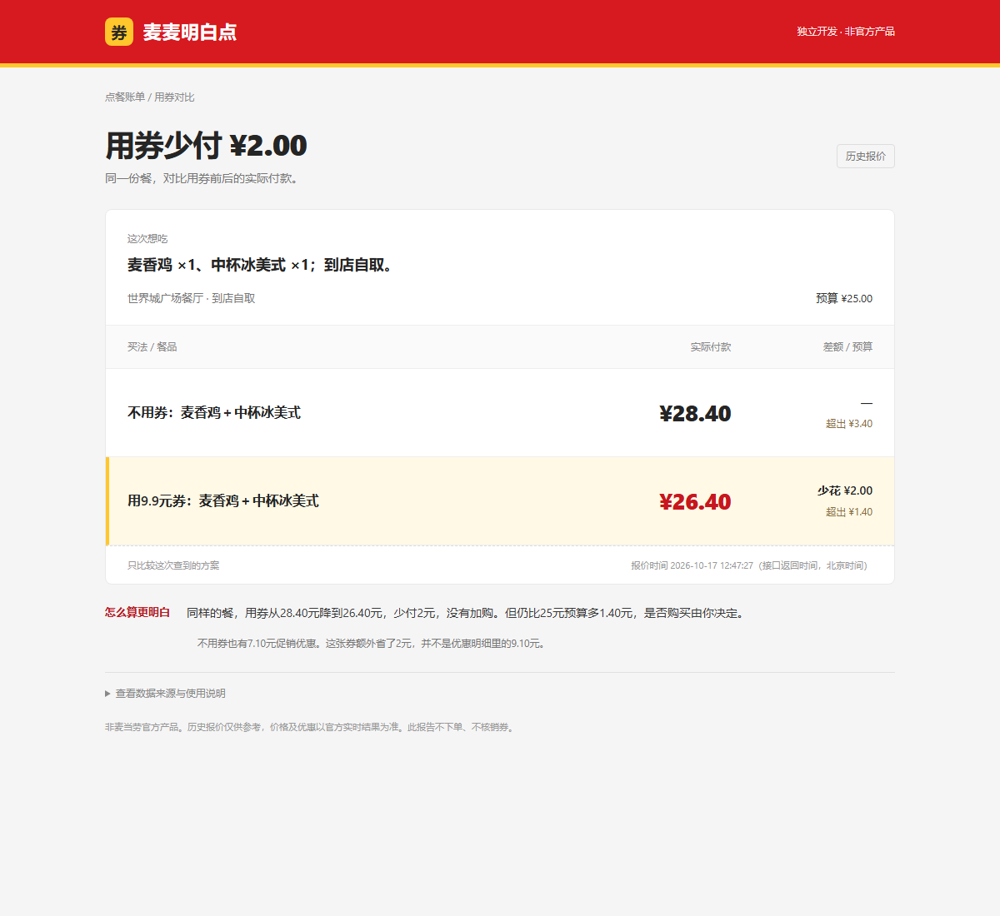
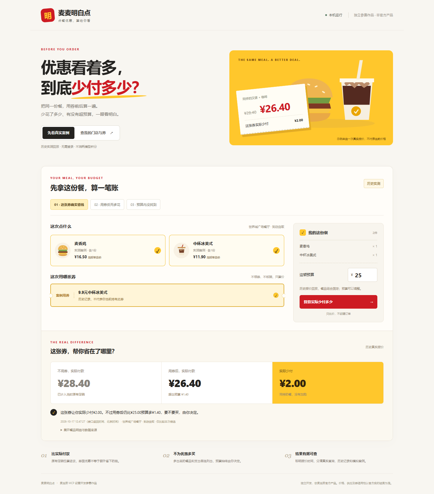

# 麦麦明白点

**这张优惠券，到底让我少付了多少？**

基于麦当劳 MCP 的点餐报价对比 Skill 与本地工具。比较实际付款金额、检查预算，提醒额外加购；价格便宜也不会自动认定符合口味要求。非麦当劳官方产品。

## 一个已经验证的案例
2026年10月17日，世界城广场餐厅到店自取，同样的麦香鸡＋中杯冰美式：

| 买法 | 实际应付 |
|---|---:|
| 不用券，已有促销 | 28.40元 |
| 使用9.9元中杯冰美式券 | 26.40元 |
| 真正少付 | **2.00元** |

用券后的总优惠为9.10元，但其中7.10元不用券也能享受，不能都算成这张券的功劳。用券后仍超25元预算1.40元，不会为用券自动增加预算。真实脱敏记录：[MCP_COUPON_RUN_03.md](docs/MCP_COUPON_RUN_03.md)。价格仅代表当时的门店、账号和时点。



## 目标用户
想按预算点餐、判断优惠是否划算，且希望看懂推荐理由的用户。不为用券主动增加预算，不因临期催促购买。

## 可视化使用：不用填编码
```powershell
python app.py ui --open
```

打开本机页面，即可先体验历史实测或模拟案例。Windows可双击 `start-ui.cmd`。实时查询时配置自己的Token或已有连接器，直接搜索门店、选餐品和券，再看实际差额；不需要手填门店或商品编码。详情见 [可视化指南](docs/UI_GUIDE.md)。



## 30秒离线体验
安装 Python 3.10 或更新版本，下载或克隆本仓库：https://github.com/bigjiaoniu/mcd-smart-choice 。无第三方依赖，不需要模型会员或 Token。打开终端进入项目目录：

```powershell
python app.py demo
```

双击生成的 `local/report.html`。这是历史真实用券结果回放，不会实时查询。默认只比较指定餐品的价格，不额外假设无糖等口味要求。原始无糖需求与未确认状态保留在测试记录中，未改写历史证据。更多演示：

```powershell
python app.py demo --case no-match
python app.py demo --case extra-spend
python app.py demo --case saving
```

后两项全部为模拟数据，仅演示多花/少花的计算逻辑，不代表真实活动。默认输出路径相同；需要保留多个报告时添加 `--output local/my-report.html`。

## 用自己的账号查询
先在[官方开放平台](https://open.mcd.cn/mcp)申请 Token。按 [实时使用指南](docs/LIVE_USAGE.md)设置本机环境变量，或显式指定已有 MCP 配置路径。不要把 Token 写进命令、仓库或聊天。

已知门店及单品编码时，一条命令完成详情查询、适用券查询、双报价、计算和中文报告：

```powershell
python app.py live --store 1960088 --product 1450 --product 507411 --coupon-product 507411 --budget 25 --need "一个鸡肉汉堡和一份无糖饮品，不接受瓶装水"
```

以上编码来自历史验证，其他门店/时段可能不可售。程序读取你账号的券，不要求有同一张券。没有匹配券仍展示普通报价；多张匹配券时要求用 `--coupon-title` 缩小选择。真实查询需要网络，不调用付费模型，也不消耗 WorkBuddy 模型积分。

第一版入口仅支持到店自取、单品默认规格、每个单品1件。它对用户已选择的餐品比价，**不自动理解自然语言选餐**；自然语言澄清和选择可交给 `skills/mcd-smart-choice/SKILL.md`。套餐、有特殊选配要求的餐品会停止，避免猜参数。

## 需求与价格分开判断
默认需求状态为待确认。只有确实已确认餐品和口味要求时才使用 `--needs-status confirmed`，不得以此绕过缺失的无糖证明。预算独立由代码检查。没有满足需求的基线时，不计算“满足需求的方案节省”；但相同餐品、数量与特制选择的用券前后价格仍可比较。

## 测试
```powershell
python -m unittest discover -s tests -v
```

## 项目结构与参赛材料
- `app.py`：统一入口，离线演示 / 实时查询。
- `scripts/`：MCP查询客户端、报价适配、整数分计算与HTML报告。
- `skills/mcd-smart-choice/SKILL.md`：可供兼容客户端读取的Skill；原生技能安装尚未验证。
- `examples/`：标明来源的历史真实记录和模拟输入。
- `MCP_INTEGRATION.md`：工具、调用流程和价值。
- `mcp-config.example.json`：环境变量占位配置；变量语法需按客户端适配。
- `CONTEST_DECLARATION.md`：官方原始声明，禁止修改。
- `workbuddy.md`：开发记录入口，已按参与者转发内容整理摘录，完整客户端导出仍待补充；专项奖励以审核为准。
- `docs/RELEASE_CHECKLIST.md`：发布与报名待办。

## 数据与权限
只调用查询/价格试算工具，不下单、领券、支付、兑换或抽奖。新查询输出默认保存到被Git忽略的 `local/`，仅含白名单字段；仍需在公开前人工检查需求文字等自填内容。不要公开本机配置、完整券码、账号、手机号、私人地址或原始工具响应。

## 当前边界
真实单品用券链路及可视化“搜索门店→选餐品→选券→双报价”已验证；营养/糖含量匹配、套餐选配、原生Skill安装和独立用户试用尚未验证。不保证全局最低价。干净目录验证与实时入口验证见 docs/VERIFICATION.md。项目已公开发布于 https://github.com/bigjiaoniu/mcd-smart-choice 。比赛报名及完整WorkBuddy对话导出尚未完成。
